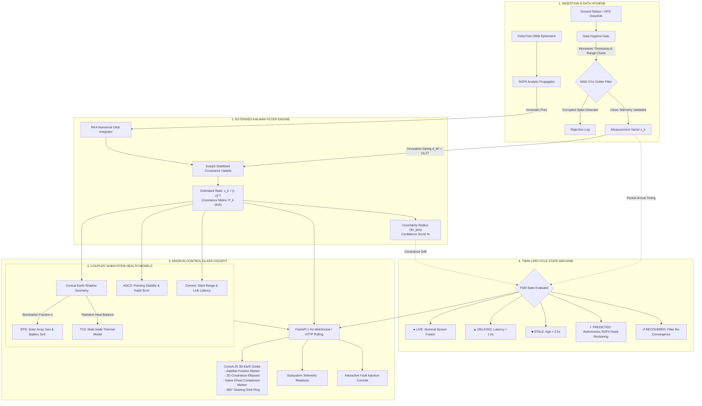
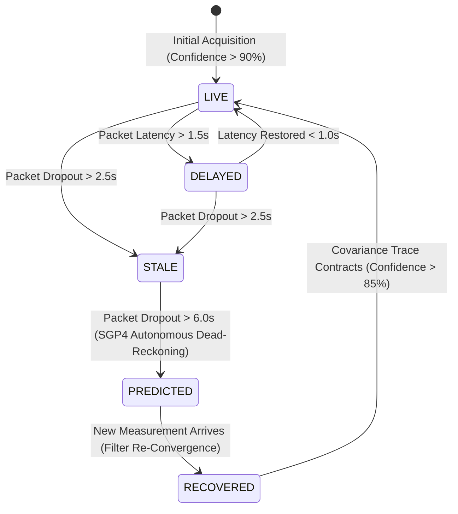

<div align="center">

# 🛰️ ORBITAL — Cyber-Physical Satellite Digital Twin

### High-Fidelity Orbital State Estimation, Coupled Subsystem Health Physics & 3D Mission Control Cockpit

[](https://satellitedigitaltwin.vercel.app/)
[](https://www.python.org/)
[](https://fastapi.tiangolo.com/)
[](https://cesium.com/platform/cesiumjs/)
[](#-verification--test-suite)
[](LICENSE)

<br/>

**[🌍 Experience the Live Production Dashboard](https://satellitedigitaltwin.vercel.app/)** • **[📑 System Architecture](#-system-architecture)** • **[📐 Mathematical Formulations](#-mathematical-rigor--orbital-physics)** • **[🧪 Fault Injection Sandbox](#-interactive-fault-injection-sandbox)**

<br/>

</div>

---

## 🧭 Executive Summary

Satellite telemetry downlinks are inherently vulnerable to ground-station occultations, atmospheric attenuation, transponder latency, and deep-space signal drops. Traditional satellite tracking platforms act as **naive visualizers**: when packets drop, they freeze in place, extrapolate naively, or plot erroneous sensor spikes.

**ORBITAL** is an industrial-grade **Cyber-Physical Digital Twin** designed by Team **Tragic Bytes** (BMS Institute of Technology & Management, Space Tech & Data Systems track). Rather than displaying raw measurements, ORBITAL fuses **SGP4 analytical orbital propagation** with a **6-DOF Extended Kalman Filter (EKF)**, coupled **subsystem physics models** (EPS solar power, TCS radiative thermal balance, Earth shadow geometry), and a resilient **5-state twin lifecycle engine**.

When ground-station telemetry drops, ORBITAL **autonomously engages dead-reckoning orbital propagation** while dynamically expanding its **3D Kalman covariance confidence ellipsoid** to mathematically represent growing positional uncertainty.

```
       NAIVE TRACKER                             ORBITAL DIGITAL TWIN
┌─────────────────────────────┐           ┌─────────────────────────────────────────┐
│ Signal Severed:             │    VS     │ Signal Severed:                         │
│ • Freezes last known coord  │           │ • Seamlessly propagates via SGP4 & RK4  │
│ • Zero uncertainty metric   │           │ • FSM switches: LIVE ➔ PREDICTED        │
│ • Ignores subsystem physics │           │ • 3D Covariance Ellipsoid widens        │
│ • Blind to eclipse entry    │           │ • EPS & TCS models continue radiative sim│
└─────────────────────────────┘           └─────────────────────────────────────────┘
```

---

## 🌟 Key Capabilities

### 1. 🛰️ 6-State Extended Kalman Filter (EKF) Orbit Fusion
- **6-DOF Kinematic Vector**: $\mathbf{x} = [x, y, z, v_x, v_y, v_z]^T \in \mathbb{R}^6$ in Earth-Centered Earth-Fixed (ECEF) coordinates.
- **4th-Order Runge-Kutta (RK4) Orbit Integrator**: Integrates central Earth gravitational acceleration ($\mu = 3.986 \times 10^5 \text{ km}^3/\text{s}^2$) with adaptive sub-stepping.
- **Joseph-Form Stabilized Covariance Update**: Guarantees positive semi-definiteness of matrix $P$ under numerical roundoff errors.
- **Dynamic 3D Uncertainty Ellipsoid**: Real-time $3\sigma_{pos}$ confidence sphere mapped in CesiumJS that contracts on measurement fusion and widens on telemetry blackout.

### 2. 🛡️ Data Hygiene & Innovation Gating
- **Monotonic Timestamp Gate**: Rejects out-of-order, stale, and duplicate telemetry packets.
- **$3.5\times$ Median Absolute Deviation (MAD) Filter**: Strips high-frequency sensor spikes before data reaches the filter.
- **$\chi^2$ Mahalanobis Distance Gate**: Rejects measurement innovations with $d_M^2 > 16.27$ ($p < 0.001$, 3 DOF) to prevent corrupted GPS/radar measurements from diverging the filter.

### 3. ⚡ Coupled Subsystem Health Physics
- **Conical Earth Shadow Geometry**: Exact computation of solar vector, cylindrical umbra, penumbra, and solar illumination fraction $\eta \in [0.0, 1.0]$.
- **Electrical Power System (EPS)**: Dynamic solar array generation ($P_{gen} = P_{max} \cdot \eta \cdot \cos\theta_{sun}$), battery charge/discharge kinetics, and State-of-Charge (SoC %).
- **Thermal Control System (TCS)**: Multi-node radiative equilibrium balancing solar absorption ($\alpha$), Earth infrared/albedo flux, and Stefan-Boltzmann radiative cooling ($\epsilon \sigma A_r T^4$).
- **Communications & ADCS**: Slant-range propagation latency tracking and attitude pointing stability scoring.

### 4. 🌍 Cinematic 3D CesiumJS Mission Control HMI
- **Atmospheric Rayleigh Scattering**: Cinematic blue atmospheric lighting and space illumination.
- **Procedural Multi-Scale Cloud Texture**: Real-time canvas procedural noise with dynamic horizontal drift.
- **360° Glowing Orbit Ring**: High-visibility cyan glowing trajectory polyline (`#48cfff`) encircling the Earth.
- **3D Satellite Schematic & Follow Mode**: Press **`F`** to engage close-up 3D satellite camera tracking; press **`Esc`** to return to space overview.
- **Comparative Naive Tracker Ghost**: Simultaneous visual comparison showing a raw naive marker that freezes when the feed is cut, visually proving the digital twin's superiority.

### 5. 🧪 Interactive Fault Injection Sandbox
Operators can inject simulated real-time anomalies through the HMI or REST API:
- `[⚡ Sever Feed]`: Simulates antenna loss or orbital occultation.
- `[⏱️ +4.0s Delay]`: Injects transmission lag to trigger the `DELAYED` state.
- `[💥 Outlier Spikes]`: Injects rogue 50 km GPS jumps to demonstrate MAD and $\chi^2$ rejection.
- `[↺ Reset All]`: Restores nominal telemetry.

---

## 🏗️ System Architecture



---

## 🔄 Twin Lifecycle State Machine



| State | Badge Color | Trigger Condition | Twin Engine Behavior |
|---|---|---|---|
| **LIVE** | `#10b981` (Emerald) | Continuous packet arrival ($\Delta t < 2.5\text{s}$, latency $< 1.5\text{s}$) | Full SGP4 + EKF measurement fusion; high confidence ($\approx 99\%$). |
| **DELAYED** | `#f59e0b` (Amber) | Packet latency exceeds $1.5\text{s}$ | Timestamps adjusted; fusion executed with historical covariance back-propagation. |
| **STALE** | `#f97316` (Orange) | No packet received for $> 2.5\text{s}$ | Measurement update skipped; EKF runs in open-loop prediction mode. |
| **PREDICTED** | `#38bdf8` (Sky Blue) | Signal lost for $> 6.0\text{s}$ | Full autonomous dead-reckoning; 3D covariance ellipsoid widens. |
| **RECOVERED** | `#06b6d4` (Cyan) | Fresh measurement received after dropout | Filter computes innovation, updates state, and rapidly contracts covariance. |

---

## 📐 Mathematical Rigor & Orbital Physics

### 1. Extended Kalman Filter (EKF) Formulations
The orbital state is modeled by non-linear two-body dynamics with central Earth gravity:
$$\dot{\mathbf{x}} = f(\mathbf{x}) = \begin{bmatrix} \mathbf{v} \\ -\frac{\mu}{\|\mathbf{r}\|^3}\mathbf{r} \end{bmatrix}$$

#### A. State Propagation (Runge-Kutta 4th Order)
$$\mathbf{x}_{k|k-1} = \mathbf{x}_{k-1} + \frac{\Delta t}{6}(k_1 + 2k_2 + 2k_3 + k_4)$$
Where:
- $k_1 = f(\mathbf{x}_{k-1})$
- $k_2 = f(\mathbf{x}_{k-1} + \frac{\Delta t}{2} k_1)$
- $k_3 = f(\mathbf{x}_{k-1} + \frac{\Delta t}{2} k_2)$
- $k_4 = f(\mathbf{x}_{k-1} + \Delta t \, k_3)$

#### B. Covariance Propagation
$$P_{k|k-1} = F_k P_{k-1|k-1} F_k^T + Q_k$$
The continuous-to-discrete state transition Jacobian $F_k \approx I_6 + \left.\frac{\partial f}{\partial \mathbf{x}}\right|_{\mathbf{x}_{k-1}} \Delta t$ is computed via the gravity gradient tensor $G \in \mathbb{R}^{3 \times 3}$:
$$G = -\frac{\mu}{r^3} I_3 + \frac{3\mu}{r^5} (\mathbf{r}\mathbf{r}^T), \quad F_k = \begin{bmatrix} I_3 & I_3 \Delta t \\ G \Delta t & I_3 \end{bmatrix}$$

#### C. Joseph-Form Stabilized Measurement Update
When measurement $\mathbf{z}_k$ passes the innovation gate:
$$\tilde{\mathbf{y}}_k = \mathbf{z}_k - H \mathbf{x}_{k|k-1}$$
$$S_k = H P_{k|k-1} H^T + R_k$$
$$K_k = P_{k|k-1} H^T S_k^{-1}$$
$$\mathbf{x}_{k|k} = \mathbf{x}_{k|k-1} + K_k \tilde{\mathbf{y}}_k$$
$$P_{k|k} = (I - K_k H) P_{k|k-1} (I - K_k H)^T + K_k R_k K_k^T$$

The $3\sigma$ positional confidence radius visualized on Cesium is derived directly from the position covariance partition:
$$\sigma_{pos} = \sqrt{\text{Tr}(P_{pos})}, \quad R_{3\sigma} = 3 \cdot \sigma_{pos}$$

---

### 2. Thermal Radiative Balance (TCS)
The multi-node radiative thermal model computes core temperature $T_c$ and solar array temperature $T_a$ by balancing instantaneous heat inputs and radiator emissive dissipation:
$$C_{thermal} \frac{dT}{dt} = Q_{in} - Q_{out}$$
$$Q_{in} = \alpha A_s S_0 \eta + Q_{albedo} + Q_{earth\_ir} + P_{internal}$$
$$Q_{out} = \epsilon \sigma_{SB} A_{radiator} T^4$$

---

### 3. Electrical Power System (EPS)
Solar array generation considers solar incidence angle $\theta$ and conical Earth shadow illumination fraction $\eta$:
$$P_{gen} = P_{max} \cdot \eta \cdot \cos(\theta_{sun})$$
$$\frac{d(SoC)}{dt} = \frac{P_{gen} - P_{bus}}{E_{battery\_capacity}} \times 100\%$$

---

## 🧪 Interactive Fault Injection Sandbox

The platform provides a live testbed to demonstrate cyber-physical resilience against raw telemetry failure:

| Fault Injection | Operational Effect | Twin State Machine Response | Naive Tracker Comparison |
|---|---|---|---|
| **Feed Severance** | Cuts incoming downlink stream | Enters `PREDICTED` mode; SGP4 dead-reckons orbit; 3D covariance ellipsoid expands from $300\text{ m}$ to $15\text{ km}$. | **FREEZES** in place at the last packet (`SIGNAL_LOST_FROZEN`). |
| **Transmission Latency** | Introduces 4.0s packet delay | Enters `DELAYED` mode; adjusts filter timestamps; maintains covariance stability. | Lags 4 seconds behind true orbital position. |
| **Sensor Outlier Spikes** | Injects rogue 50 km measurement jumps | $3.5\times$ MAD and $\chi^2$ innovation gate reject corrupted packets; prevents filter divergence. | Plots violent, unrealistic jumps across Earth. |

---

## 🛠️ Technology Stack

| Domain | Technology | Purpose |
|---|---|---|
| **Backend Framework** | [FastAPI](https://fastapi.tiangolo.com/) | High-performance asynchronous REST & WebSocket streaming |
| **Astrodynamics** | [SGP4](https://pypi.org/project/sgp4/), [Skyfield](https://rhodesmill.org/skyfield/) | Analytical ephemeris propagation & TEME/ECEF/ITRF coordinate frames |
| **Scientific Math** | [NumPy](https://numpy.org/), [SciPy](https://scipy.org/) | Vectorized RK4 integration, matrix inversion & covariance analysis |
| **3D Visualization** | [CesiumJS](https://cesium.com/platform/cesiumjs/) | Interactive WebGL 3D Earth globe, trajectory polylines, 3D ellipsoids |
| **Styling & HMI** | Modern Glassmorphism & CSS3 | Dark-theme space mission control interface with real-time status glows |
| **Serverless Deployment** | [Vercel](https://vercel.com/) | Zero-config edge hosting with automatic 1 Hz HTTP polling fallback |
| **Testing** | [Pytest](https://docs.pytest.org/), [HTTPX](https://www.python-httpx.org/) | 24 automated unit, integration, and mathematical test suites |

---

## 📂 Project Directory Structure

```text
Satellite_Digital_Twin/
├── api/
│   └── index.py                     # Vercel serverless ASGI entry point
├── backend/
│   ├── app/
│   │   ├── adapters/
│   │   │   ├── celestrak.py         # CelesTrak OMM ephemeris ingestion
│   │   │   └── simulator.py         # True kinematic trajectory simulator
│   │   ├── api/
│   │   │   ├── routes.py            # REST endpoints (telemetry, faults, targets)
│   │   │   └── websocket.py         # 1 Hz broadcast engine & client manager
│   │   ├── models/
│   │   │   ├── measurement.py       # Pydantic schemas for telemetry frames
│   │   │   └── satellite.py         # Satellite orbital parameter models
│   │   ├── pipeline/
│   │   │   ├── fault_injector.py    # Testbed for feed cuts, latency & noise
│   │   │   ├── hygiene.py           # MAD outlier gate & monotonicity check
│   │   │   └── state_machine.py     # 5-state twin lifecycle transition engine
│   │   ├── twin/
│   │   │   ├── anomaly_detector.py  # Chi-squared residual anomaly monitor
│   │   │   ├── coordinate.py        # TEME <-> ECEF <-> Geodetic conversions
│   │   │   ├── eclipse.py           # Conical Earth shadow & solar vector geometry
│   │   │   ├── ekf.py               # 6-DOF Extended Kalman Filter & RK4 engine
│   │   │   ├── engine.py            # Master Digital Twin orchestrator
│   │   │   ├── health_models.py     # EPS power & TCS thermal physics models
│   │   │   └── propagator.py        # SGP4 analytical propagation wrapper
│   │   └── main.py                  # FastAPI application entry point
│   ├── tests/
│   │   ├── test_celestrak.py        # OMM parsing & validation tests
│   │   ├── test_coordinate.py      # ECEF/Geodetic conversion verification
│   │   ├── test_eclipse_health.py   # Conical shadow & thermal balance tests
│   │   ├── test_ekf.py              # EKF covariance contraction/expansion tests
│   │   ├── test_engine_routes.py    # REST & Fault injection integration tests
│   │   ├── test_pipeline_hygiene.py # MAD filter & state machine lifecycle tests
│   │   └── test_simulator.py        # Kinematic simulator tests
│   ├── pyproject.toml               # Poetry/pip tooling configuration
│   └── requirements.txt             # Python backend dependencies
├── frontend/
│   ├── static/
│   │   ├── css/
│   │   │   └── style.css            # Mission control glassmorphism theme
│   │   └── js/
│   │       └── dashboard.js         # Cesium globe, procedural clouds & telemetry HMI
│   └── templates/
│       └── index.html               # Semantic mission control layout
├── docs/
│   └── Tragic_Bytes_Satellite_Digital_Twin.pptx # Architecture pitch deck
├── requirements.txt                 # Root dependencies for Vercel build
├── vercel.json                      # Vercel serverless routing configuration
└── README.md                        # Master project documentation
```

---

## ⚡ Quickstart & Local Setup

### Prerequisites
- Python 3.12 or newer
- Git

### 1. Clone & Enter the Repository
```bash
git clone https://github.com/Kshitiz-Khandelwal/Satellite_Digital_Twin.git
cd Satellite_Digital_Twin
```

### 2. Set Up Virtual Environment
```bash
# On Linux/macOS
python3 -m venv .venv
source .venv/bin/activate

# On Windows PowerShell
python -m venv .venv
.\.venv\Scripts\Activate.ps1
```

### 3. Install Dependencies
```bash
cd backend
pip install -r requirements.txt
```

### 4. Run the Digital Twin Server
```bash
python -m uvicorn app.main:app --host 127.0.0.1 --port 8000 --reload
```

### 5. Access the Cockpit
- **Mission Control 3D Dashboard**: [http://127.0.0.1:8000/](http://127.0.0.1:8000/)
- **Interactive Swagger API Docs**: [http://127.0.0.1:8000/docs](http://127.0.0.1:8000/docs)
- **Service Health Check**: [http://127.0.0.1:8000/health](http://127.0.0.1:8000/health)

---

## 🧪 Verification & Test Suite

The repository contains 24 automated mathematical and integration tests verifying EKF covariance contraction, Runge-Kutta energy conservation, conical eclipse geometry, MAD outlier rejection, and REST endpoints:

```bash
cd backend
python -m pytest -v
```

```text
============================= test session starts =============================
platform win32 -- Python 3.14.5, pytest-9.1.1, pluggy-1.6.0
collected 24 items

tests/test_celestrak.py::test_celestrak_refresh PASSED                   [  4%]
tests/test_celestrak.py::test_invalid_satellite_id PASSED                [  8%]
tests/test_celestrak.py::test_missing_omm_fields PASSED                  [ 12%]
tests/test_celestrak.py::test_invalid_eccentricity PASSED                [ 16%]
tests/test_coordinate.py::test_teme_to_ecef PASSED                       [ 20%]
tests/test_coordinate.py::test_ecef_to_geodetic PASSED                   [ 25%]
tests/test_coordinate.py::test_geodetic_values_are_valid PASSED          [ 29%]
tests/test_coordinate.py::test_invalid_position_rejected PASSED          [ 33%]
tests/test_coordinate.py::test_naive_timestamp_rejected PASSED           [ 37%]
tests/test_eclipse_health.py::test_eclipse_sunlight_vs_umbra PASSED      [ 41%]
tests/test_eclipse_health.py::test_health_simulator_power_in_sunlight_and_eclipse PASSED [ 45%]
tests/test_ekf.py::test_ekf_prediction_widens_covariance PASSED          [ 50%]
tests/test_ekf.py::test_ekf_update_contracts_covariance PASSED           [ 54%]
tests/test_ekf.py::test_ekf_rk4_energy_conservation PASSED               [ 58%]
tests/test_engine_routes.py::test_engine_step_produces_valid_telemetry_frame PASSED [ 62%]
tests/test_engine_routes.py::test_engine_fault_injection_feed_severance PASSED [ 66%]
tests/test_engine_routes.py::test_fastapi_rest_endpoints PASSED          [ 70%]
tests/test_pipeline_hygiene.py::test_hygiene_mad_outlier_rejection PASSED [ 75%]
tests/test_pipeline_hygiene.py::test_state_machine_lifecycle_transitions PASSED [ 79%]
tests/test_pipeline_hygiene.py::test_fault_injector_sever_and_noise PASSED [ 83%]
tests/test_simulator.py::test_simulator_generates_measurement PASSED     [ 87%]
tests/test_simulator.py::test_simulator_health PASSED                    [ 91%]
tests/test_simulator.py::test_invalid_simulator_configuration PASSED     [ 95%]
tests/test_simulator.py::test_naive_timestamp_rejected PASSED            [100%]

============================= 24 passed in 1.50s ==============================
```

---

## 📡 REST API Reference

| Endpoint | Method | Description |
|---|---|---|
| `/` | `GET` | Serves the CesiumJS 3D Mission Control Glass Cockpit. |
| `/health` | `GET` | Service health status and version identifier. |
| `/api/status` | `GET` | Returns twin operational state and active fault configuration. |
| `/api/telemetry/snapshot`| `GET` | Returns instantaneous synchronized telemetry frame (position, EKF covariance, EPS/TCS health). |
| `/api/faults/inject` | `POST` | Injects simulated faults (`feed_cut`, `packet_latency_s`, `sensor_noise_km`). |
| `/api/faults/reset` | `POST` | Clears all active faults and restores nominal operations. |
| `/api/select-satellite/{norad_id}` | `POST` | Dynamically re-initializes twin tracking for specified NORAD satellite. |
| `/ws/telemetry` | `WebSocket` | Real-time 1 Hz streaming downlink broadcasting telemetry frames. |

---

## 👥 Team & Academic Credits

Developed by **Team Tragic Bytes**  
**BMS Institute of Technology & Management (BMSIT&M)**  
*Space Tech & Data Systems Track*

---

## 📄 License

This project is open-source and distributed under the **MIT License**. See [`LICENSE`](LICENSE) for details.
